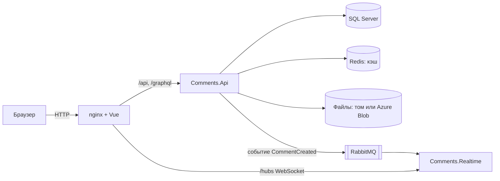

# SPA «Комментарии»

Одностраничное приложение для комментариев с каскадными ответами, вложениями и обновлениями в реальном времени.
Тестовое задание, уровень **Middle+**.

**Демо:** http://inna-comments-test-1955c.germanywestcentral.cloudapp.azure.com
(Swagger: `/swagger`, GraphQL: `/graphql`). Адрес открывается по `http`, HTTPS не настраивался.

**Стек:** .NET 10, ASP.NET Core, EF Core 10, SQL Server 2022, Redis 7, RabbitMQ 4, SignalR, GraphQL (Hot Chocolate), Vue 3 + TypeScript + Vite, nginx, Docker, Azure (VM и Blob Storage).

## Содержание

1. [Соответствие ТЗ](#соответствие-тз)
2. [Быстрый запуск (Docker)](#быстрый-запуск-docker)
3. [Запуск для разработки](#запуск-для-разработки)
4. [Настройки](#настройки)
5. [Архитектура](#архитектура)
6. [Ключевые решения](#ключевые-решения)
7. [Безопасность](#безопасность)
8. [Тесты и нагрузка](#тесты-и-нагрузка)
9. [Схема базы данных](#схема-базы-данных)
10. [Развёртывание в Azure](#развёртывание-в-azure)
11. [Масштабирование](#масштабирование)
12. [Как бы я делал это для себя](#как-бы-я-делал-это-для-себя)
13. [Отступления от ТЗ и ограничения](#отступления-от-тз-и-ограничения)
14. [Git](#git)

## Соответствие ТЗ

| Требование | Как сделано |
|---|---|
| Комментарии с каскадными ответами | Корень и плоский список ответов с `parentId`, дерево строит клиент (рекурсивный компонент). Лимит ветки 1000 ответов |
| User Name: латинские буквы и цифры, обязательно | Проверка в браузере и на сервере (`[A-Za-z0-9]+`) |
| E-mail обязателен, Home page необязателен (URL) | Атрибуты валидации на сервере, те же правила в браузере |
| CAPTCHA с буквами и цифрами | Собственная картинка (SkiaSharp), код одноразовый, живёт 5 минут. Включена по умолчанию (`Captcha:Enabled`) |
| Text: только `<a href title>`, `<code>`, `<i>`, `<strong>`, теги должны закрываться | Серверный `CommentTextValidator` (белый список, закрытие, вложенность) и его копия в браузере; перед показом текст очищает DOMPurify |
| Таблица корневых комментариев: сортировка по User Name, E-mail, дате в обе стороны, по умолчанию LIFO, 25 на страницу | `ORDER BY` в базе, вторым ключом `Id`; клик по заголовку меняет направление; страницы по 25 |
| Защита от XSS и SQL-инъекций | См. [Безопасность](#безопасность) |
| Вложение: JPG, GIF, PNG до 320×240 (пропорциональное уменьшение) или TXT до 100 КБ; просмотр с эффектами | Уменьшение в браузере (canvas), повторная проверка сервером по содержимому; lightbox с плавным появлением; TXT открывается в окне просмотра |
| Валидация на клиенте и сервере | Да, одни и те же правила и сообщения |
| Предпросмотр без перезагрузки | Рисуется в браузере тем же санитайзером, что и показ |
| Кнопки `[i] [strong] [code] [a]` | Оборачивают выделенный текст |
| EF, свежий .NET, Vue, Git, Docker | EF Core 10, .NET 10, Vue 3, ветки Git, `docker compose` |
| Развёрнуто на хостинге | Azure VM, Docker, адрес выше |
| Схема БД для MySQL Workbench | [Схема базы данных](#схема-базы-данных) |
| README: запуск с нуля | Разделы «Быстрый запуск» и «Запуск для разработки» |
| **Junior+:** очередь, кэш, события, WebSocket | Очередь событий в памяти и RabbitMQ; Redis и HybridCache; событие `CommentCreated`; SignalR |
| **Middle:** Graph, брокер, NoSQL, облако | GraphQL (только чтение); RabbitMQ; Redis; Azure (VM и Blob Storage) |
| **Middle+:** архитектура на 1 млн сообщений и 100 тыс. пользователей в сутки, нагрузочный тест | Разделы [Масштабирование](#масштабирование) и [Тесты и нагрузка](#тесты-и-нагрузка) |

## Быстрый запуск (Docker)

Нужны Docker и Docker Compose. Больше ничего ставить не нужно.

```
git clone https://github.com/Nik444/comments-spa.git
cd comments-spa
docker compose up -d --build
docker compose ps
```

Первая сборка занимает несколько минут. На Windows вместо команд выше можно дважды щёлкнуть `start.bat` (он соберёт и запустит проект, дождётся готовности и откроет сайт), остановить можно через `stop.bat`. Когда у `api` и `realtime` статус `healthy`:

| Что | Адрес |
|---|---|
| Сайт | http://localhost:8080 |
| Swagger | http://localhost:8080/swagger |
| GraphQL (редактор Nitro) | http://localhost:8080/graphql |
| RabbitMQ (логин `comments`, пароль `comments_dev`) | http://localhost:15672 |

Остановить: `docker compose down` (данные в томах сохраняются), `docker compose down -v` (удалит и данные).

Что запускается: SQL Server, Redis, RabbitMQ, `api`, `realtime` и nginx с фронтендом (`web`). Порядок запуска задан проверками здоровья: сначала база, Redis и RabbitMQ, затем сервисы, затем nginx. Миграции базы применяются при старте Api.

Пароли в `docker-compose.yml` это значения по умолчанию **только для локальной разработки**. На сервере они задаются через файл окружения (см. [Развёртывание](#развёртывание-в-azure)). Вложения по умолчанию хранятся в томе Docker; Azure для запуска не нужен.

## Запуск для разработки

Нужны .NET 10 SDK, Node 22 и Docker (для инфраструктуры).

```
docker compose up -d db redis rabbitmq        # только инфраструктура
```

1. Откройте `backend/Comments.sln` в Visual Studio, запустите `Comments.Api` (профиль `http`: http://localhost:5160) и `Comments.Realtime` (http://localhost:5170). Если база пустая, примените миграции: `dotnet ef database update` из `backend/Comments.Api`. В режиме разработки капча выключена (`appsettings.Development.json`).
2. Фронтенд:
   ```
   cd frontend
   npm install
   npm run dev          # http://localhost:5173
   ```
   Vite проксирует `/api` и `/hubs`, поэтому CORS не нужен. Адреса можно переопределить переменными `API_URL` и `REALTIME_URL`.

Тесты: `dotnet test backend/Comments.sln` и `npm test` (из папки `frontend`).

## Настройки

Любую настройку из `appsettings.json` можно задать переменной окружения с двойным подчёркиванием (`Cache__Mode`). В `docker-compose.yml` основные настройки выведены в переменные, которые читаются из файла `.env` (образец: `.env.example`).

| Настройка | По умолчанию | Назначение |
|---|---|---|
| `Comments:PageSize` | 25 | Корневых комментариев на странице |
| `Comments:MaxRepliesPerThread` | 1000 | Предел ответов в ветке |
| `Comments:MaxIdsPerRequest` | 200 | Id в одном запросе `by-ids` |
| `Cache:Mode` | `Memory` (в Docker `Hybrid`) | `Off`, `Memory` (память), `Hybrid` (память и Redis) |
| `Captcha:Enabled` | `true` | Капча (`CAPTCHA_ENABLED` в Docker) |
| `Storage:Provider` | `Local` | `Local` (диск, том Docker) или `AzureBlob` |
| `Storage:ServiceUri` / `Storage:ConnectionString` | пусто | Вход в Blob Storage: без секретов через управляемую идентификацию (адрес службы) или строка подключения |
| `Storage:CacheMinutes` | 0 | Кэш файлов перед хранилищем (в Redis), 0 выключен |
| `Database:MigrateOnStart` | `true` в Docker | Применять миграции при старте Api |

## Архитектура



- **Comments.Api** принимает и читает комментарии (REST и GraphQL), хранит вложения, публикует события.
- **Comments.Realtime** отдельный сервис, держит WebSocket-подключения SignalR. В базу не ходит.
- **Comments.Contracts** общие описания событий.
- **Redis** кэш страниц и комментариев (в режиме `Hybrid`). **RabbitMQ** связывает Api и Realtime. Код капчи хранится в памяти процесса Api (`MemoryCaptchaStore`).

**Создание комментария:** проверка (капча, поля, теги, файл) → запись в базу → запись в кэш → событие в очередь в памяти → фоновая отправка в RabbitMQ → Realtime собирает события пачкой около секунды и рассылает **сигналы с Id**.

**Почему сигналы, а не сами комментарии:** экономия трафика (по WebSocket идут только Id); нет лавины запросов (данные запрашивают только те, кто подписан на ветку или нажал «+N новых»); комментарий уже лежит в кэше (его кладут туда до публикации события), поэтому запросы идут не в базу.

**Что видит пользователь:** вверху списка кнопка «+N новых», у корня кнопка «+N ответов»; по клику клиент запрашивает комментарии по Id (`GET /api/comments/by-ids`). Если новых ответов в ветке больше 200, предлагается обновить страницу. Страница сама не прыгает и не теряет набранный текст; при закрытии вкладки с несохранённым текстом браузер просит подтвердить.

## Ключевые решения

- **Только добавление данных.** В ТЗ нет правки и удаления, поэтому комментарий неизменяем и кэшируется целиком.
- **Страница читается двумя запросами без рекурсии:** 25 корней (`OFFSET/FETCH` по индексам, отфильтрованным по корням), затем все их ответы одним запросом `RootId IN (...)`.
- **Кэш страниц:** первые 5 и последние 5 страниц, 2 секунды, склейка одновременных запросов (нет лавины к базе). Страницы из середины не кэшируются: повторно их почти не запрашивают, а перебором номеров можно было бы забить кэш.
- **Кэш по Id:** 5 минут в памяти и 60 минут в Redis, пачка Id читается одним запросом. Ошибки Redis не ломают запрос, комментарии читаются из базы.
- **События не блокируют запись:** между запросом и RabbitMQ стоит очередь в памяти, медленный или упавший брокер не тормозит создание комментария. Цена: при падении процесса между записью и отправкой событие теряется, данные при этом корректны (клиент увидит новое при обновлении страницы). Строгую доставку даёт Outbox, это описано в разделе про масштабирование.
- **Вложения проверяются по содержимому, а не по расширению:** сигнатура и размеры из заголовка PNG/GIF/JPEG (без декодирования), TXT только в UTF-8 без управляющих символов. Лимиты: картинка до 1 МБ и 320×240, текст до 100 КБ, запрос до 2 МБ. Ключ файла случайный (32 hex-символа), отдача с `nosniff` и `Content-Security-Policy: sandbox`.
- **Хранилище файлов подключается через интерфейс `IFileStorage`:** диск или Azure Blob переключаются настройкой. Перед ним можно включить кэш в Redis. Redis как единственное хранилище не используется: данные в нём не гарантированы.
- **Свои типы исключений** (`InvalidCaptchaException` и др.): обработчик различает бизнес-ошибки по типу и превращает их в 400/409 с нужным полем; стандартные `InvalidOperationException` или `ArgumentException` бросают и другие слои, их нельзя безопасно считать ответом клиенту.
- **GraphQL только для чтения** и тонкий слой над тем же `CommentService`: кэши и лимиты общие с REST. Поля: `comments(page, sortBy, sortDir)`, `commentById(id)`, `commentsByIds(ids)`. Запись остаётся в REST, потому что там файл, капча и вся проверка формы.
- **Фронтенд без UI-библиотек и роутера** (Vue 3, TypeScript, Vite): одна страница, свой CSS, тёмная тема.

<details>
<summary>Контракт SignalR-хаба</summary>

Адрес `/hubs/comments`, только WebSocket. Клиент вызывает `SubscribeRoots(long[] rootIds)` (до 50 корней страницы, повторный вызов заменяет набор, после переподключения вызов нужно повторить). Сервер вызывает у клиента `NewRoots(long[] ids)` (всем) и `NewReplies(long rootId, long[] ids)` (подписанным на ветку). Подписки хранятся в группах SignalR `root:{id}`, сервис больше ничего не хранит. Каждый экземпляр Realtime имеет свою очередь RabbitMQ (fanout), поэтому события получают все экземпляры.
</details>

## Безопасность

- **XSS.** Сервер принимает только белый список тегов (`a href title`, `code`, `i`, `strong`) с проверкой закрытия и вложенности. Перед показом текст дополнительно очищает DOMPurify, ссылки только `http(s)`, открываются с `rel="noopener noreferrer nofollow"`. TXT-вложение отдаётся как `text/plain` и показывается как текст. nginx отдаёт `Content-Security-Policy`, `X-Content-Type-Options: nosniff`, `X-Frame-Options: DENY`.
- **SQL-инъекции.** Все запросы идут через EF Core с параметрами, строк SQL из пользовательского ввода нет. Сортировка выбирается из закрытого списка полей.
- **Загрузки.** Проверка по содержимому, ограничения размера, случайные имена, отдача из изолированного контекста.
- **Сеть на сервере.** SQL Server, Redis и RabbitMQ слушают только `127.0.0.1` хоста; снаружи открыты только 80 (сайт) и 22 (SSH с одного адреса). Доступ к Blob Storage идёт через управляемую идентификацию VM, ключей в конфигурации нет.
- **Секреты.** В репозитории нет паролей сервера и ключей облака. Файлы `.env*` (кроме `.env.example`) игнорируются Git.

## Тесты и нагрузка

Модульные тесты xUnit в `backend/Comments.Tests` (валидаторы текста и вложений, ключи файлов, хранилища файлов, капча, пакетирование сигналов, мапперы, запросы) и vitest во фронтенде (93 теста).

Нагрузочный тест: k6, скрипты в `loadtest/` (`light.js` для смеси чтения и записи на развёрнутом сайте, `read.js` и `seed.sql` для чтения при 1 млн комментариев). Целевой профиль в пересчёте на запросы в секунду: 1 млн сообщений в сутки это около 12 записей в секунду в среднем и 35 и больше в пик, 100 тыс. пользователей это 60–120 запросов в секунду на чтение в пик (допущения: 10 страниц на пользователя, пик в 3–10 раз выше среднего).

**Облако:** одна VM (2 vCPU, 4 ГБ), все шесть контейнеров, клиент k6 через интернет из Киева, до 15 тысяч комментариев в базе.

| Пользователей | Запросов в секунду | p(95) | p(95) записи | Ошибок | Записей в секунду |
|---|---|---|---|---|---|
| 100 | около 100 | 80 мс | 84 мс | 0 | около 13 |
| 400 | около 386 | 81 мс | 87 мс | 0 | около 50 |
| 1000 | около 963 | 84 мс | 93 мс | 0 | около 125 |

На 1000 пользователях машина занята примерно наполовину (около 105% из 200% процессорного времени, Api около 60%, nginx 25%, SQL Server 12–18%), память контейнеров меньше 1 ГБ из 3,8. Это с большим запасом выше пикового профиля. Оговорки: предел не найден (нагрузка равна числу пользователей), базы небольшие, вложения и WebSocket не нагружались, каждый прогон проведён один раз, 30 мс задержки это сеть.

**Локально, 1 млн комментариев в базе, только чтение** (режимы кэша, `Cache:Mode`):

| Режим | Запросов в секунду | p(95) | p(95) первой страницы |
|---|---|---|---|
| `Off` | 36 | 4,3 с | 1,0 с |
| `Memory` | 261 | 1,0 с | 251 мс |
| `Hybrid` | 306 | 0,98 с | 159 мс |

Кэш страниц даёт рост пропускной способности примерно в 8 раз. Глубокие страницы (середина и конец списка) остаются медленными, 2,6–3 с: `OFFSET` пропускает строки. Это главное известное ограничение, решение описано ниже (курсорная подгрузка).

## Схема базы данных

Файл для MySQL Workbench: [`docs/db/schema.mysql.sql`](docs/db/schema.mysql.sql) (File → Open SQL Script, выполнить, затем Database → Reverse Engineer для EER-диаграммы). Рабочая база проекта SQL Server, файл описывает ту же схему на диалекте MySQL (в MySQL нет фильтрованных индексов, поэтому они обычные). Единственная таблица `Comments`: `Id`, `ParentId`, `RootId`, `UserName`, `Email`, `HomePage`, `Text`, `CreatedAt`, колонки вложения (`AttachmentKind`, `AttachmentKey`, `AttachmentName`, `AttachmentSize`). У корня `ParentId` и `RootId` пустые, у ответа заполнены оба (контролирует `CHECK`). Индексы: корни по дате, по имени, по e-mail (отфильтрованные по `ParentId IS NULL`), ответы по `(RootId, CreatedAt)`.

## Развёртывание в Azure

Одна виртуальная машина Ubuntu 24.04 (2 vCPU, 4 ГБ, регион Germany West Central), Docker и Docker Compose. Вложения лежат в Azure Blob Storage (приватный контейнер).

- **Доступ без секретов.** VM входит в хранилище через системную управляемую идентификацию с ролью «Storage Blob Data Contributor». Ключевой доступ к аккаунту запрещён.
- **Файл окружения `.env.azure`** (не в Git) содержит случайные пароли SQL Server и RabbitMQ, адрес Blob-службы и настройки (`STORAGE_PROVIDER=AzureBlob`, `STORAGE_CACHE_MINUTES`). Образец: `.env.example`.
- **Сеть.** Входящие только 80 и 22 (SSH с одного адреса); базы, Redis и RabbitMQ закрыты.
- **Деплой с рабочей машины:** Docker подключается к VM по SSH (контекст `docker context create azure --docker "host=ssh://<пользователь>@<адрес>"`), сборка и запуск идут на сервере:
  ```
  docker context use azure
  docker compose --env-file .env.azure up -d --build
  ```

## Масштабирование

Целевая схема для 1 млн сообщений и 100 тыс. пользователей в сутки и выше:

1. **Балансировщик** (nginx, Azure Load Balancer или Application Gateway) перед несколькими экземплярами Api (без состояния) и отдельно перед несколькими Realtime (`least_conn`; события приходят всем экземплярам через fanout).
2. **Отдельный сервер базы данных** (Azure SQL или SQL Server Standard) с читающей репликой: чтение страниц идёт на реплику, запись на основной узел. Нужно потому, что SQL Server Express ограничен 10 ГБ на базу: комментарий с индексами занимает порядка 1 КБ (оценка), миллион в сутки это около 1 ГБ в сутки.
3. **Разделение на сервисы:** один сервис записывает данные в базу и публикует событие (в той же транзакции, через Outbox: событие записывается вместе с комментарием и отправляется в RabbitMQ фоновой задачей, поэтому не теряется); сервисы Realtime раздают сигналы; отдельные сервисы читают (чтение это 80–90% трафика, ему нужно много узлов и реплика базы, а записи гораздо меньше).
4. **Redis и RabbitMQ** на отдельных узлах или управляемыми (Azure Cache for Redis, кластер RabbitMQ), с `maxmemory` и вытеснением для Redis.
5. **Капча** из памяти процесса в Redis, иначе несколько Api не будут видеть чужие капчи. Всё остальное уже общее: кэш (Redis), файлы (Blob).
6. **Файлы:** короткоживущие SAS-ссылки или CDN, трафик идёт мимо Api.
7. **Глубокие страницы:** курсорная подгрузка вместо `OFFSET` (см. следующий раздел).

## Как бы я делал это для себя

ТЗ требует анонимную форму с капчей, страницы и сортировку по имени и e-mail. Если бы я делал продукт для себя, я бы сделал иначе.

**Пользователи.** Писать могут только зарегистрированные и проверенные. Основной путь: вход через Google, Apple, GitHub (OAuth): проверку почты и пароли берёт на себя провайдер, проблема одноразовых почт почти исчезает. Запасной путь: почта с подтверждением, плюс список одноразовых доменов, проверка MX, лимиты для новых аккаунтов. Телефон только если оправдана стоимость (SMS платные, есть накрутка кодов, номер это персональные данные). Заодно пропадает вопрос «данных для идентификации клиента»: вместо IP и User-Agent есть пользователь.

**Капча.** Современная (Cloudflare Turnstile, hCaptcha, reCAPTCHA) и только при регистрации по почте. Картинки с буквами современные ИИ решают, но и современные капчи не абсолютны (есть сервисы с живыми людьми). Поэтому капча лишь замедляет, а защищают слои: подтверждённый аккаунт, лимиты, репутация, модерация.

**Ограничения.** Не чаще одного комментария в 15 секунд (настраивается), проверка в Redis (`SET ... NX EX 15`), ответ 429 с `Retry-After`. Для новых аккаунтов строже, с возрастом аккаунта и положительными оценками доверие растёт. Лимиты и на регистрацию с одного IP.

**Лента без страниц.** Только по дате (фактически по `Id`, записи только добавляются) и кнопка «Показать ещё»: клиент передаёт `Id` последнего корня и получает следующие 25. Запрос `WHERE Id < @last ORDER BY Id DESC` идёт по индексу и стоит одинаково на любой глубине; сейчас середина и конец списка читаются через `OFFSET` и медленны на большой базе (см. замер выше). Бонусы: нет дублей при добавлении новых комментариев, страницы «ниже курсора» кэшируются надолго (старше суток на часы, свежее на 10 минут). Нюанс: если страница включает ответы, она неизменна не полностью, поэтому корни отдаются с числом ответов, а ветка подгружается отдельно и кэшируется по корню. Цена: нельзя перейти на страницу номер 17, для ленты это нормально.

**Рейтинг.** Голоса (уникальная пара пользователь + комментарий), топ-100 за сутки, неделю, месяц, год и лучшие по годам. Redis (sorted set) или пересчёт по расписанию; кэш на 10 минут для суток, на часы для остального; счётчики голосов копятся в Redis и сбрасываются в базу пачками.

**Фильтр по автору** вместо сортировки по имени и e-mail (индекс по автору и `Id`). E-mail в продукте не показывается публично.

**Модерация.**
1. Жалобы пользователей: один человек считается один раз, вес жалобы зависит от возраста и истории аккаунта и от доли прошлых обоснованных жалоб. Тысяча жалоб от аккаунтов, созданных сегодня, весит почти ничего; пачка жалоб от новых аккаунтов признак атаки на автора, такие жалобщики теряют вес.
2. Взвешенных жалоб больше порога (около 10 обычных жалобщиков): комментарий скрывается и уходит на проверку ИИ асинхронно через RabbitMQ (не замедляет публикацию, платный вызов только по порогу).
3. ИИ уверен в нарушении (порядка 90%): комментарий скрыт (не стёрт, для обжалования), автор забанен на срок, одинаковые копии скрываются. ИИ не уверен: ручная очередь модератора.
4. Если ИИ нарушений не нашёл, а взвешенные жалобы продолжают расти (около 1000 обычных жалобщиков), решает живой модератор, повторно ИИ не запускается.
5. Всегда работают дешёвые фильтры: лимиты, дубликаты, число ссылок, возраст аккаунта. Они ловят то, на что никто не жалуется.

Риски: уверенность ИИ не вероятность и плохо откалибрована, поэтому автоматически скрывается комментарий, а бан серьёзнее (повторные срабатывания или подтверждение человеком, обжалование); текст пользователя передаётся ИИ как данные, а не как инструкция; тексты уходят во внешний сервис, это нужно указать в политике конфиденциальности (GDPR), нужен срок хранения.

## Отступления от ТЗ и ограничения

- **IP и User-Agent не сохраняются.** ТЗ просит «данные, помогающие идентифицировать клиента». Автор определяется именем и e-mail. IP не идентифицирует человека (за одним адресом сотни людей, один человек меняет адреса), User-Agent присылает клиент и подделывается строкой кода, оба относятся к персональным данным (GDPR), а цели хранения в задаче нет. Если они нужны, это две колонки и миграция; реальный адрес за nginx читается из `X-Forwarded-For`.
- **E-mail не подтверждается**: упрощение тестового задания.
- **Лимит ветки 1000 ответов** защищает от тяжёлых страниц.
- **Уменьшение картинок в браузере:** GIF при этом становится PNG и теряет анимацию (маленький GIF уходит как есть). Сервер заново проверяет файл по содержимому и отклоняет картинки больше 320×240.
- **События хранятся в памяти** до отправки в RabbitMQ (см. Outbox выше).
- **Глубокие страницы медленные** при очень большой базе (см. замер).
- **GraphQL без защиты сложности запроса** (глубина, постоянные запросы): для публичного API нужна. Сейчас ограничены размер страницы и число Id.
- **Базы для нагрузки небольшие в облаке**, большая база измерялась только локально.

## Git

Ветки: `main` (основная), `dev` (общая разработка), `dev_front` (фронтенд), `dev_realtime` (SignalR и RabbitMQ). Разработка шла по частям в отдельных ветках с последующим слиянием.
